<div align="center">

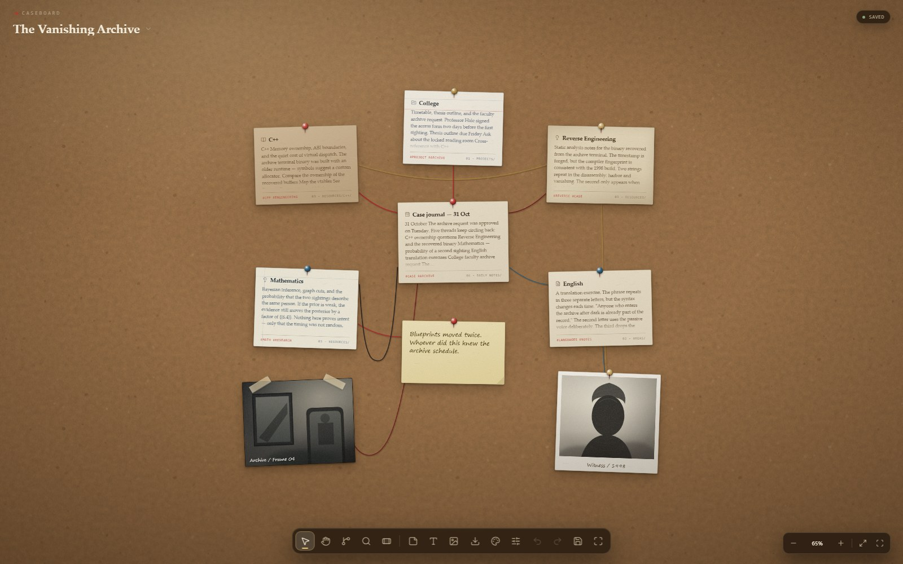

# Caseboard

**A cinematic investigation board for Obsidian.**

Notes, photographs, red thread, pins, tape, a loupe and graph imports — all stored locally inside your vault.

[](https://github.com/ZekiTRR/CaseBoard/releases/latest)
[](https://obsidian.md)
[](https://github.com/ZekiTRR/CaseBoard/actions/workflows/ci.yml)
[](LICENSE)

[Русский](README.md) · [Features](#-features) · [Gallery](#-gallery) · [Installation](#-installation) · [Build](#-build)

</div>

---

## ✨ Features

- **Multiple investigation boards** with separate names, themes, camera positions and history.
- **Notes, text cards and photographs** from the vault or from disk.
- **Red threads** with dynamic, taut and static physics, sag, tension and subtle sway.
- **Free-standing tape** — place it on notes, photos or directly on the empty board.
- **Custom tape styling** — colour picker, length, width and rotation.
- **Custom pin colour** — keep the theme presets and add an arbitrary colour through a picker.
- **Bare mode** — a note or photo without a frame, pin or tape.
- **Loupe and deep zoom** — inspect dense text without changing the board zoom.
- **Smooth navigation** — mouse wheel, trackpad, hand tool and eased camera movement.
- **Linked-note import** — graph import, recursion, folder/tag/property filters and chain refresh.
- **Five visual themes** — cork, dark investigation, concrete, vintage paper and whiteboard.
- **Custom board backgrounds** with fit and dim controls.
- **Local storage** — board files remain separate from your notes.
- **Keyboard-layout independent shortcuts** — physical-key bindings work in Russian and other layouts.

---

## 🖼 Gallery

### Themes

<table>
  <tr>
    <td width="50%">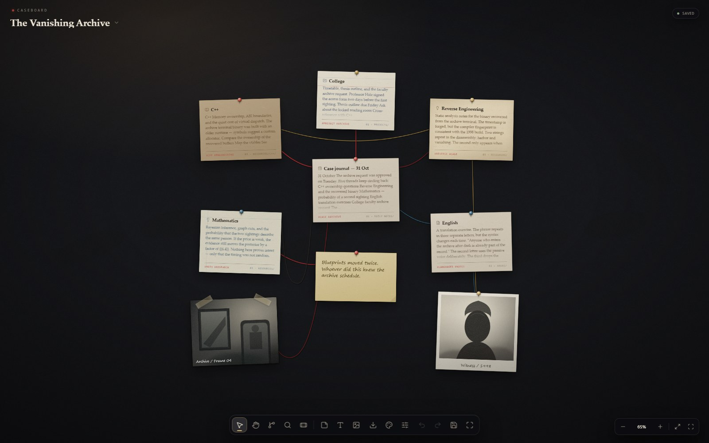</td>
    <td width="50%">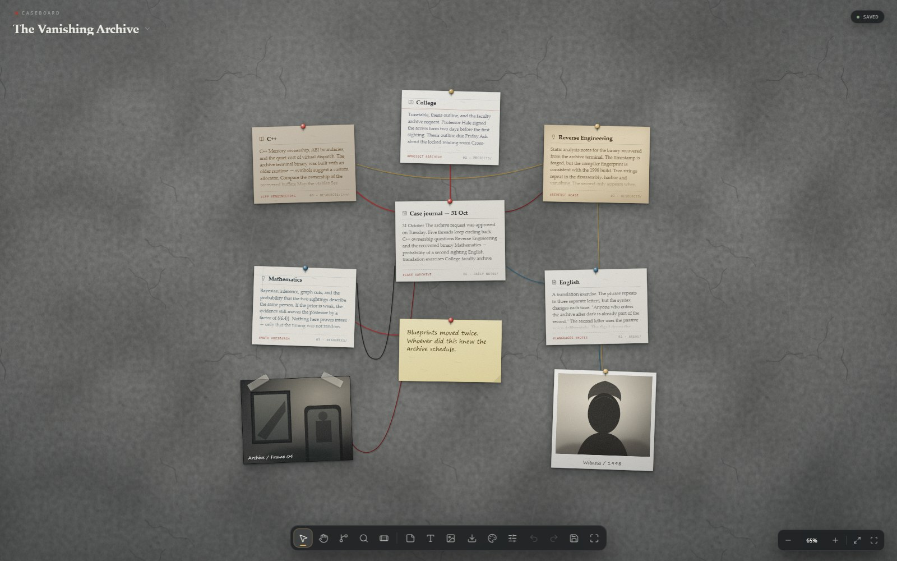</td>
  </tr>
  <tr>
    <td>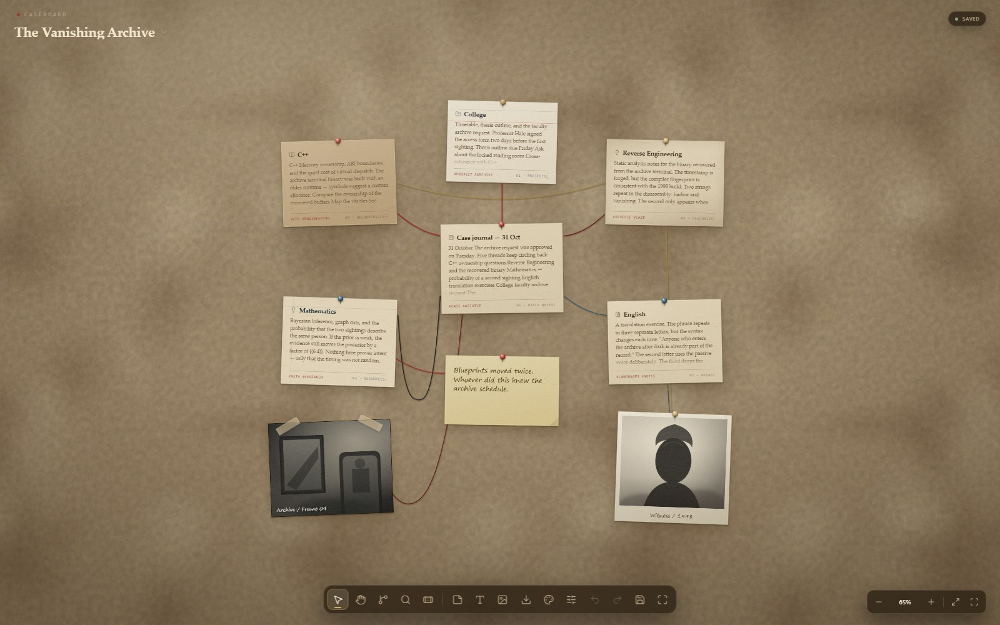</td>
    <td>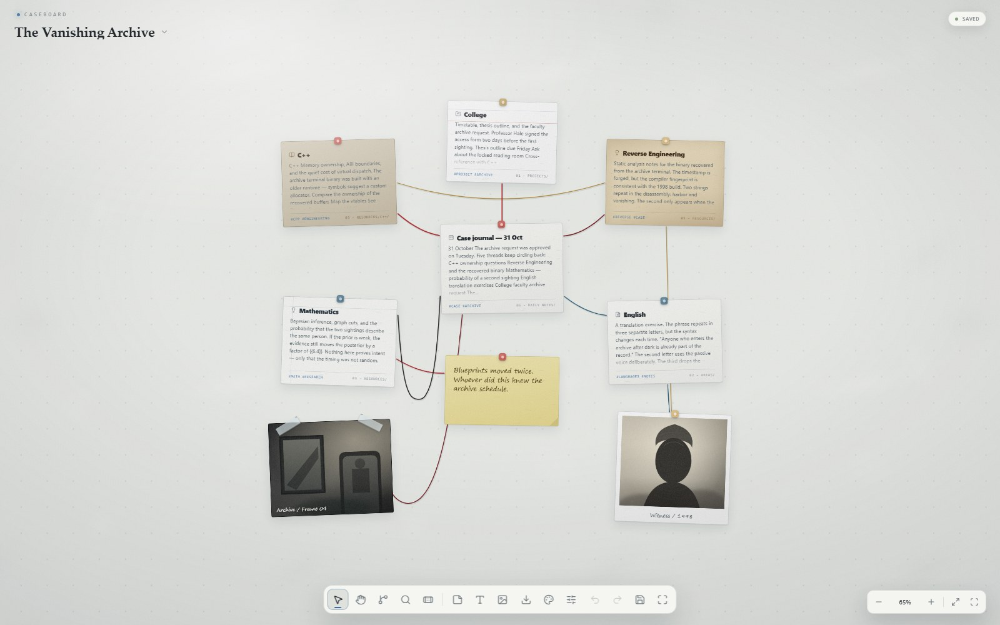</td>
  </tr>
</table>

### Materials and tools

<table>
  <tr>
    <td width="50%">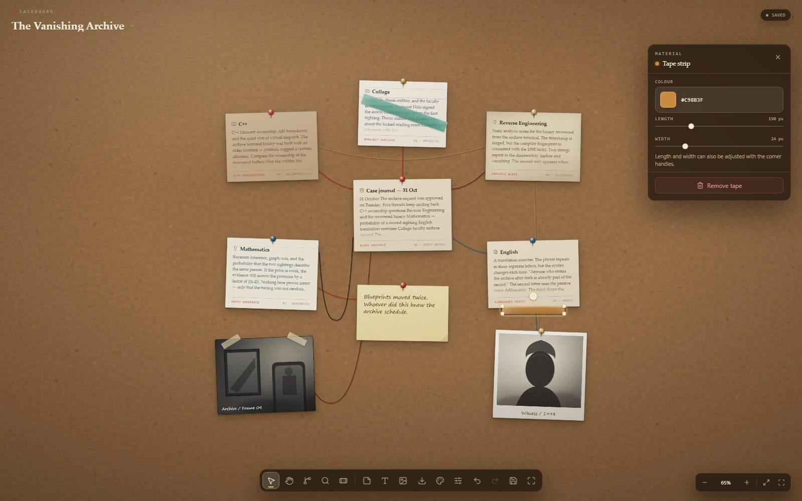</td>
    <td width="50%">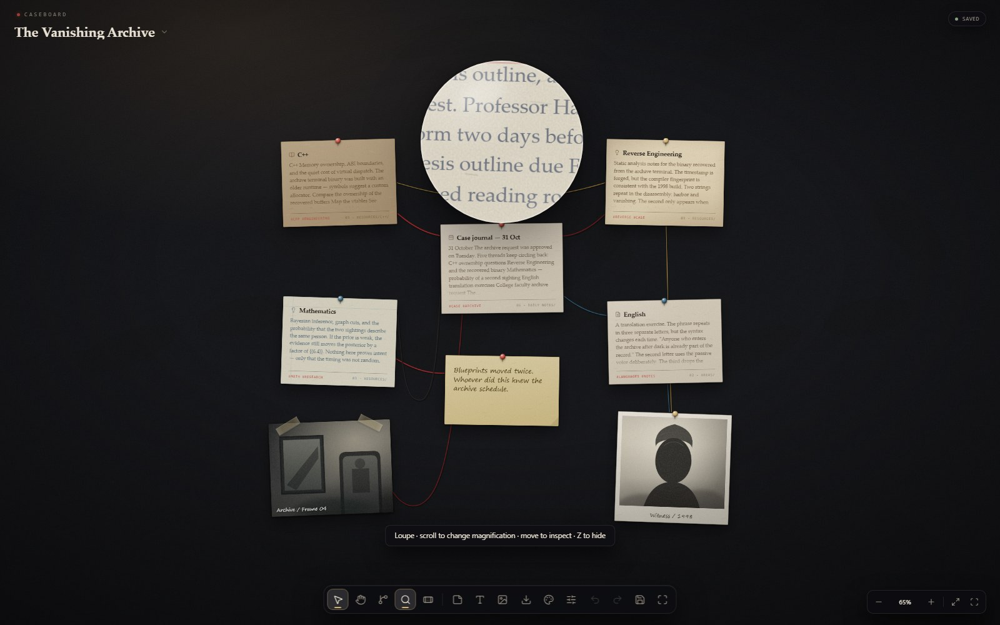</td>
  </tr>
  <tr>
    <td>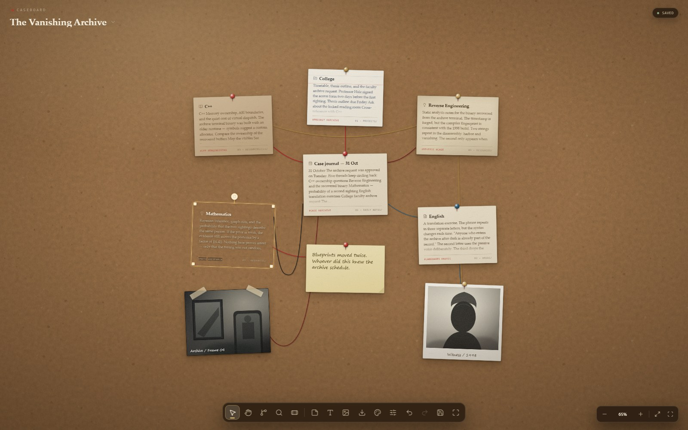</td>
    <td>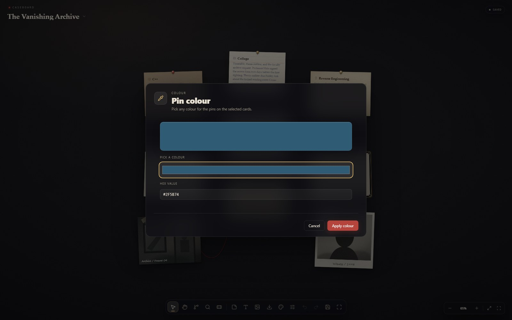</td>
  </tr>
</table>

### Import and settings

<table>
  <tr>
    <td width="50%">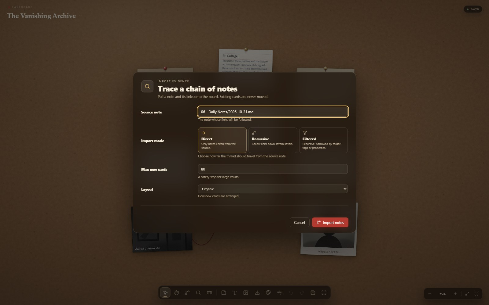</td>
    <td width="50%">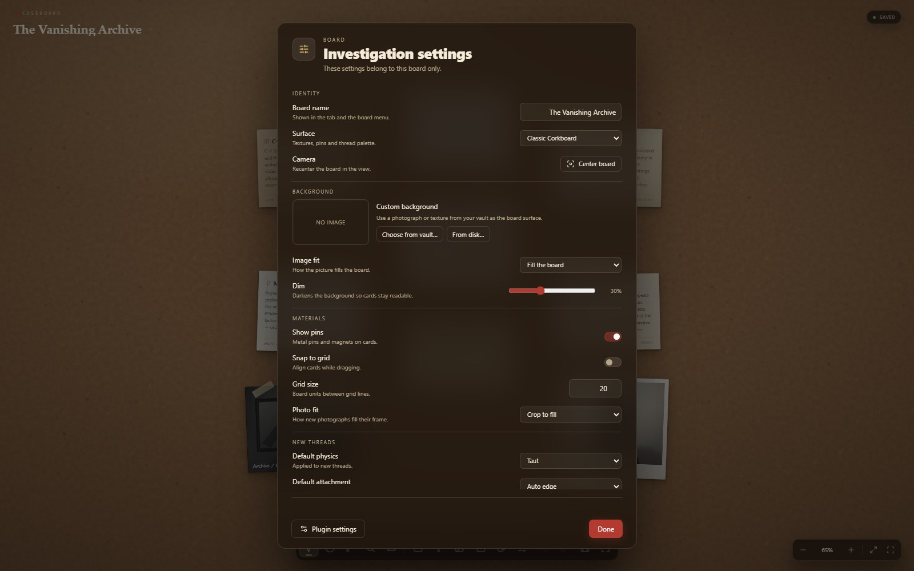</td>
  </tr>
</table>

---

## 📦 Installation

### From a release

1. Open the [latest release](https://github.com/ZekiTRR/CaseBoard/releases/latest).
2. Download `caseboard.zip`.
3. Extract it into:

   ```text
   <vault>/.obsidian/plugins/caseboard/
   ```

4. Open **Settings → Community plugins** in Obsidian and enable **Caseboard**.

### With BRAT

1. Install the **BRAT** plugin.
2. Add the experimental repository:

   ```text
   ZekiTRR/CaseBoard
   ```

3. Choose **Check for updates**, then enable Caseboard.

### Manual build

Clone the repository, follow the [build instructions](#-build), then copy `main.js`, `styles.css` and `manifest.json` into the plugin folder.

---

## 🧭 Usage

- Open a board from the pin icon in the left ribbon or with **Open Caseboard**.
- Add notes, text and photographs from the bottom toolbar.
- Select the **Thread** tool, then choose two cards to connect them.
- Select the **Tape** tool and drag across the board or over any card.
- Select a tape strip to open the **Material** panel and change its colour, length and width.
- Right-click a card to change its material, pin colour, lock state, z-order or remove it.

### Keyboard shortcuts

| Action | Shortcut |
| --- | --- |
| Select | `V` |
| Hand | `H` |
| Thread | `C` |
| Loupe | `Z` |
| Tape | `G` |
| Pin note | `N` |
| Text block | `T` |
| Photograph | `I` |
| Focus mode | `F` |
| Save | `Ctrl + S` |
| Undo | `Ctrl + Z` |
| Redo | `Ctrl + Shift + Z` |
| Duplicate | `Ctrl + D` |
| Delete | `Delete` |
| Cancel / close | `Esc` |
| Zoom to fit | `Shift + 1` |
| Zoom to selection | `Shift + 2` |
| Zoom in | `+` |
| Zoom out | `-` |

Shortcuts use the physical key position, so they continue to work with Russian and other keyboard layouts.

---

## 🗂 Storage

- Boards are saved as separate JSON files and never modify your notes.
- Choose the board location in plugin settings under **Board folder**.
- Existing board files are moved automatically when the folder changes.
- Images added to boards, including backgrounds and dropped files, are saved to **Attachment folder**.
- Leave the attachment folder empty to use Obsidian's own attachment settings.

---

## 🛠 Build

Node.js 20 or newer is required.

```bash
npm ci
npm run build
```

The build produces:

```text
main.js
styles.css
```

To publish an automatic GitHub release, create a tag:

```bash
git tag v1.0.0
git push origin v1.0.0
```

GitHub Actions builds the plugin and uploads `caseboard.zip` to Releases.

---

## 📄 License

[MIT](LICENSE)
