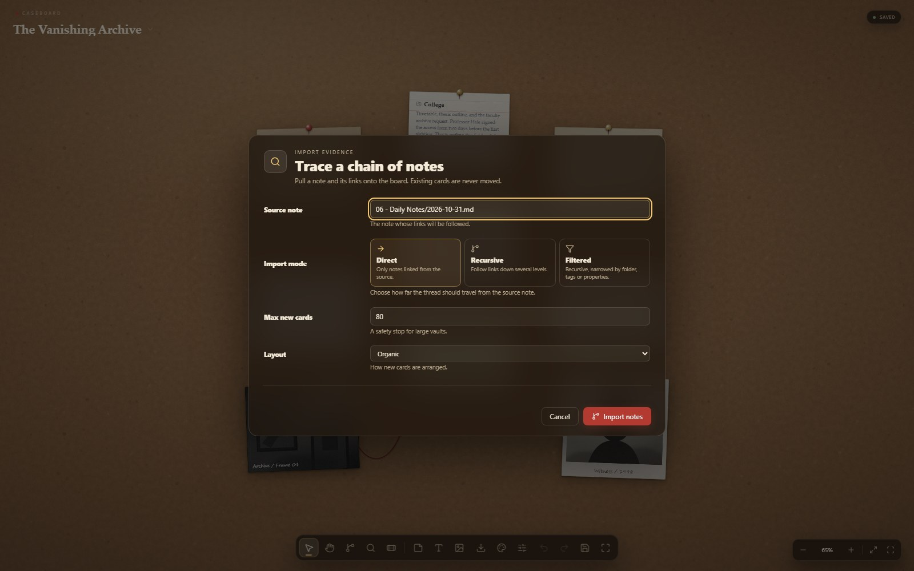

# Caseboard

**A cinematic detective investigation board for Obsidian.**

Pin notes, photographs and evidence to a cork board, connect them with red threads, and import linked notes from your vault. Everything is rendered by the plugin and stored locally — nothing ever leaves your machine.

[](https://github.com/ZekiTRR/CaseBoard/releases/latest)
[](https://obsidian.md)
[](https://github.com/ZekiTRR/CaseBoard/actions/workflows/lint.yml)
[](LICENSE)

[Русский](README.ru.md) · [Features](#-features) · [Gallery](#-gallery) · [Installation](#-installation) · [Privacy](#-privacy-and-storage) · [Build](#-build-and-release)

---

## ✨ Features

- **Multiple boards** — each with its own name, theme, camera position and undo history.
- **Notes, text cards and photographs** pulled from the vault or imported from disk.
- **Dictaphone** — record a voice note straight onto the board; the card carries a waveform drawn from the file's own peaks, a duration and a caption line.
- **Red threads** with dynamic, taut and static physics, sag, auto-tension and subtle sway.
- **Free-standing tape** — the Tape tool lays strips on cards or directly on an empty board.
- **Arbitrary tape styling** — colour picker plus length, width and rotation.
- **Custom pin colour** — theme presets stay, an arbitrary colour is one picker away.
- **Bare mode** — a note or photograph with no frame, pin or tape.
- **Loupe** with adjustable magnification, independent of the board zoom.
- **Smooth navigation** — wheel and trackpad panning, hand tool, eased camera gliding.
- **Linked-note import** — graph import, recursion, folder, tag and property filters, chain refresh.
- **Five themes** — cork, dark investigation, concrete, vintage paper, whiteboard.
- **Custom board backgrounds** with fit and dim controls.
- **Layout-independent shortcuts** — bindings use the physical key, so Russian and other layouts work.

---

## 🖼 Gallery

**Dark investigation theme.**


**Tape tool and material panel.**


**Loupe with adjustable magnification.**


**Dictaphone — recording in progress.**


**Voice note card with a waveform from the take.**


**Linked-note import.**



**Board settings.**


More looks: [cork](assets/screenshots/hero-cork.jpg), [concrete](assets/screenshots/theme-concrete.jpg), [vintage paper](assets/screenshots/theme-vintage.jpg), [whiteboard](assets/screenshots/theme-whiteboard.jpg), [bare note](assets/screenshots/bare-note.jpg), [pin colour picker](assets/screenshots/pin-color.jpg).

---

## 📦 Installation

### From the community directory

1. Open **Settings → Community plugins → Browse** in Obsidian.
2. Find **Caseboard** and install it, then enable it.

### From a GitHub release

1. Download `main.js`, `manifest.json` and `styles.css` from the [latest release](https://github.com/ZekiTRR/CaseBoard/releases/latest).
2. Copy all three files into your vault:

   ```text
   <vault>/.obsidian/plugins/caseboard/
   ```

3. Open **Settings → Community plugins** and enable **Caseboard**.

### With BRAT

Add the experimental repository `ZekiTRR/CaseBoard`, press **Check for updates**, then enable the plugin.

---

## 🧭 Using the board

- Open a board from the pin icon in the left ribbon or with the **Open the board** command.
- Add notes, text and photographs from the toolbar.
- Pick the **Thread** tool, then click two cards to connect them.
- Pick the **Tape** tool and drag across the board or over any card; a click lays a short strip.
- Press the **Dictaphone** button (or `R`) and talk; the strip above the toolbar shows the live level, **Stop & pin** drops the card where your cursor is.
- Click the ink circle on a recording to play it, click the waveform to jump to a moment, right-click the card for a caption.
- Select a tape strip to open the **Material** panel and change colour, length and width.
- Right-click a card for material modes, pin colour, lock, z-order and removal.

### Shortcuts

| Action | Key |
| --- | --- |
| Select | `V` |
| Hand | `H` |
| Thread | `C` |
| Loupe | `Z` |
| Tape | `G` |
| Dictaphone | `R` |
| Pin note | `N` |
| Text block | `T` |
| Photograph | `I` |
| Focus mode | `F` |
| Save | `Ctrl + S` |
| Undo / redo | `Ctrl + Z` / `Ctrl + Shift + Z` |
| Duplicate | `Ctrl + D` |
| Delete | `Delete` |
| Cancel / close | `Esc` |
| Zoom to fit / selection | `Shift + 1` / `Shift + 2` |
| Zoom in / out | `+` / `-` |

Keys are bound to the physical key position, so they keep working in Russian and other layouts.

The board is desktop-only: it relies on pointer hover, mouse-wheel navigation and the operating-system file picker.

---

## 🔒 Privacy and storage

- **No network access.** The plugin never makes a request, loads no remote code and sends no analytics.
- **Microphone.** The dictaphone asks Obsidian for microphone access when you press `R` or the **Dictaphone** button. Audio is captured with the browser's `MediaRecorder`, mixed down to a waveform on your machine and written into your vault; the microphone is released as soon as the take ends or is discarded. Nothing is streamed anywhere.
- **No telemetry, no accounts, no paid features.**
- Boards are stored as plain JSON files inside your vault, at **Settings → Caseboard → Board folder** (default: `.obsidian/plugins/caseboard/boards`).
- Images and recordings you add, drop or set as a background are copied to **Attachment folder**; leave it empty to follow Obsidian's own attachment settings.
- Plugin preferences live in `.obsidian/plugins/caseboard/data.json`.
- Source notes are only ever read. Caseboard writes to board JSON files and to the attachment folder you choose. Removing a card never deletes its media file.

---

## 🛠 Build and release

Node.js 20 or newer is required.

```bash
npm ci
npm run build     # typecheck + bundle main.js and styles.css
npm run lint      # eslint with eslint-plugin-obsidianmd
```

Artifacts are written to the repository root and are intentionally not committed — they ship as release assets:

```text
main.js
styles.css
```

Cut a version. `npm version` updates `manifest.json`, `package.json` and `versions.json`, then creates a tag without a `v` prefix, which Obsidian requires:

```bash
npm version patch
git push origin main
git push origin 1.0.1
```

The [release workflow](.github/workflows/release.yml) builds that tag, signs the build provenance and publishes a GitHub release carrying `main.js`, `manifest.json` and `styles.css`.

Submitting the plugin for the community directory happens at [community.obsidian.md](https://community.obsidian.md) — the repository must be public and the release published first.

---

## 📄 License

[MIT](LICENSE)
