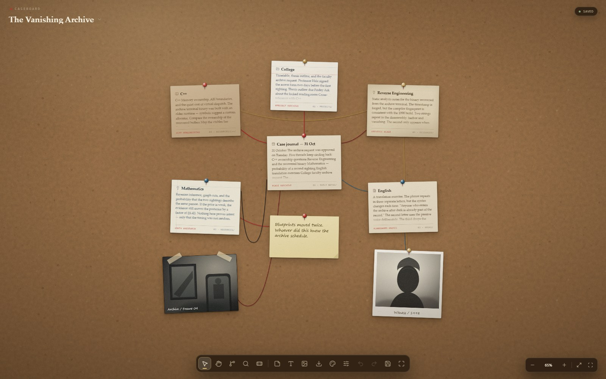
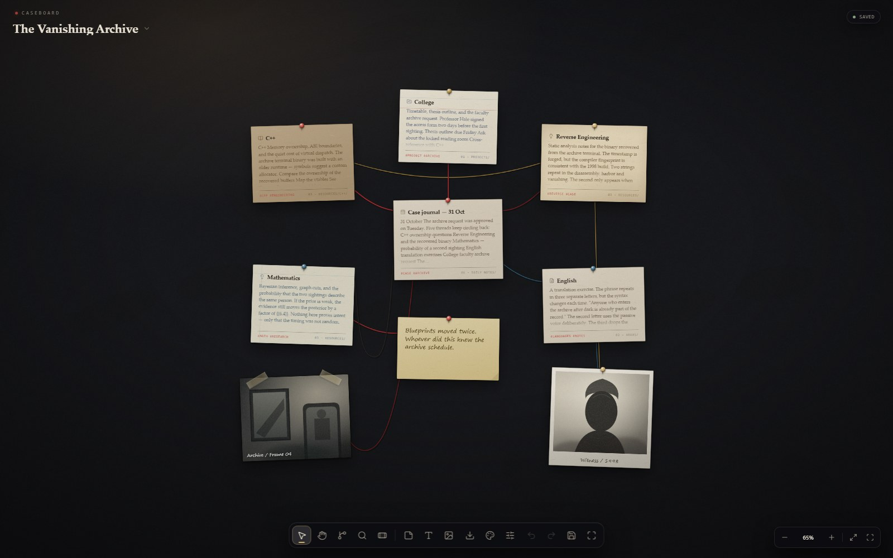
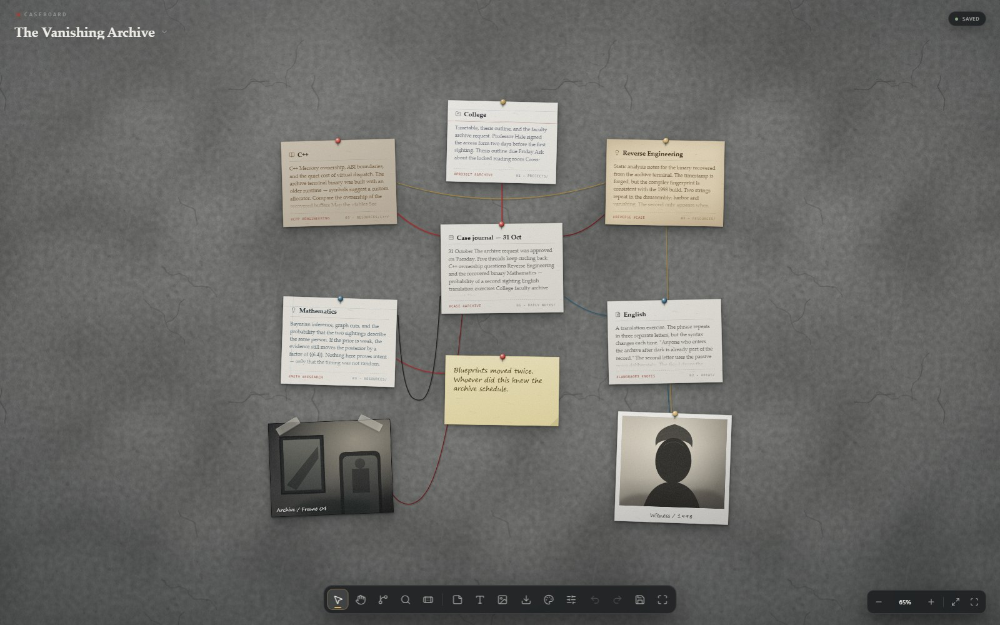
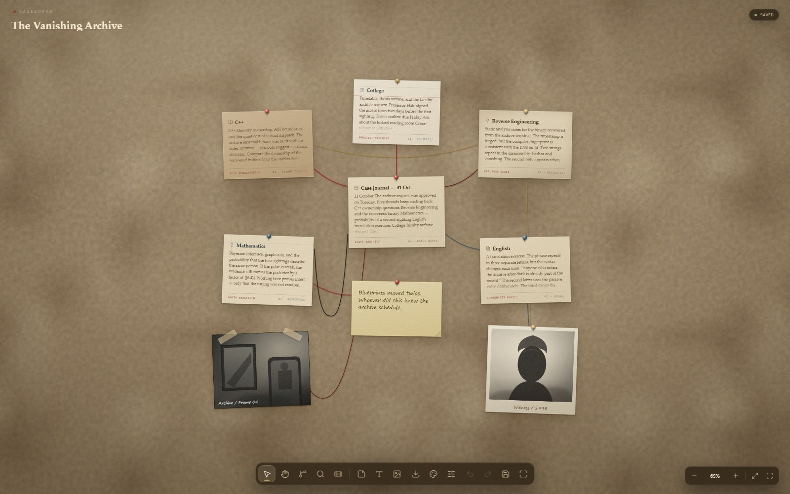
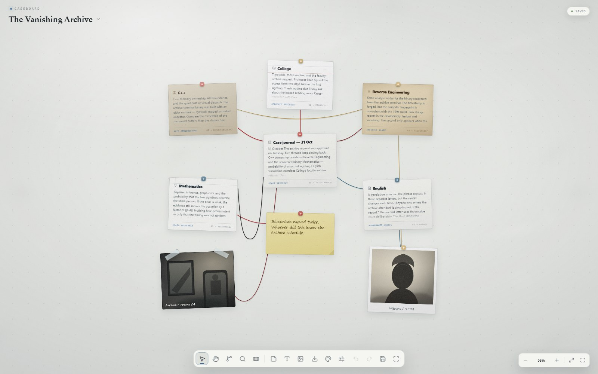
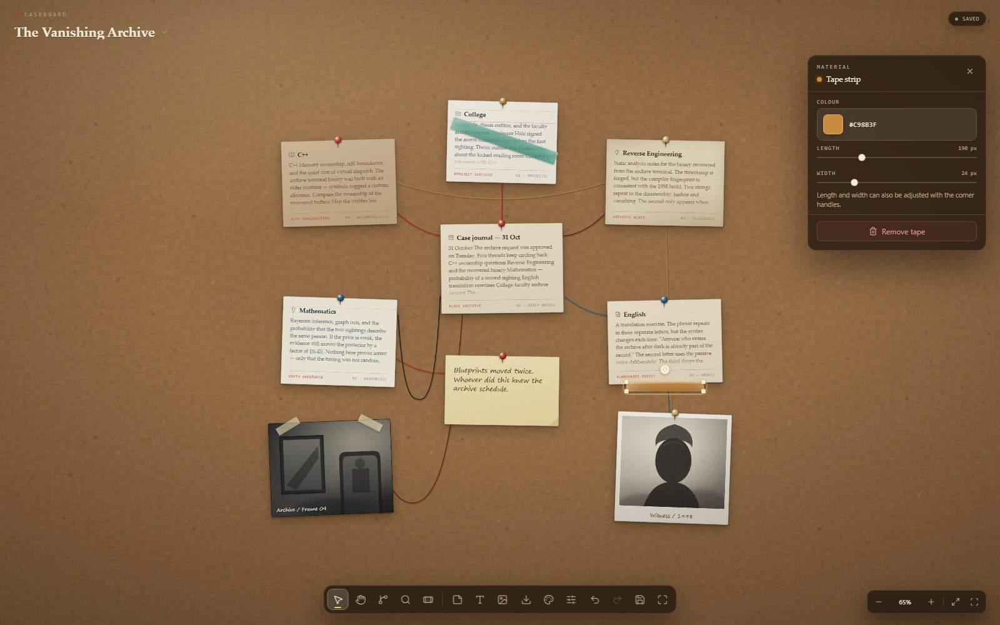
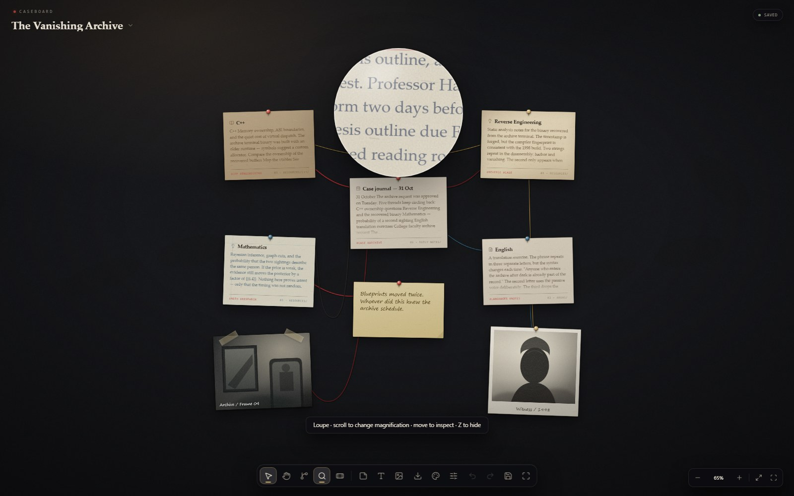
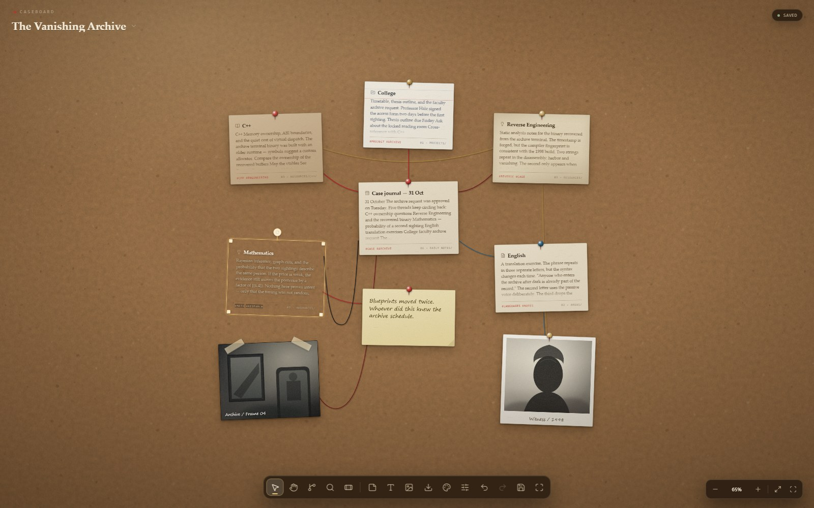
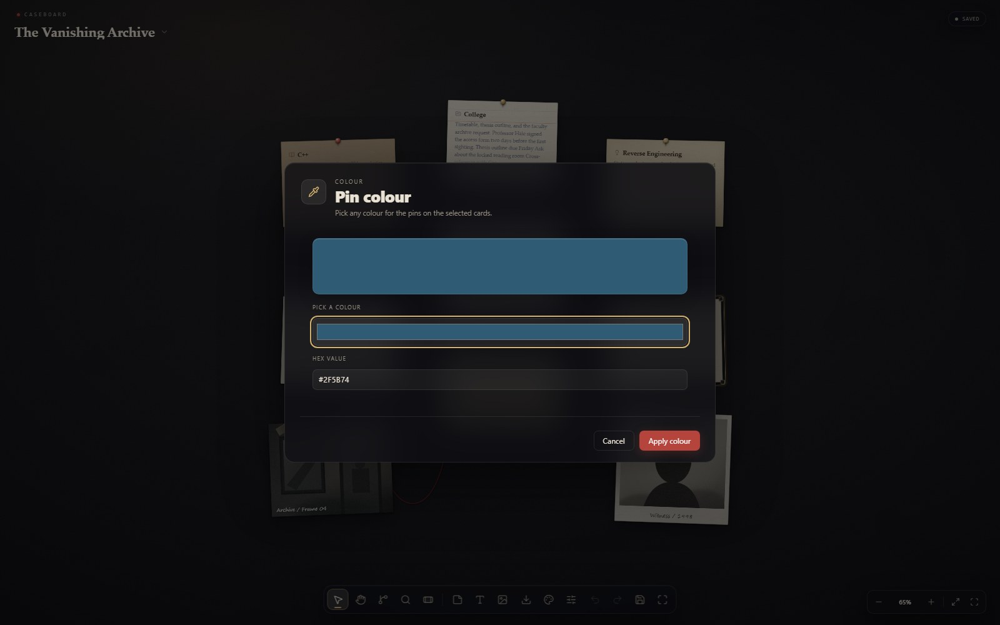
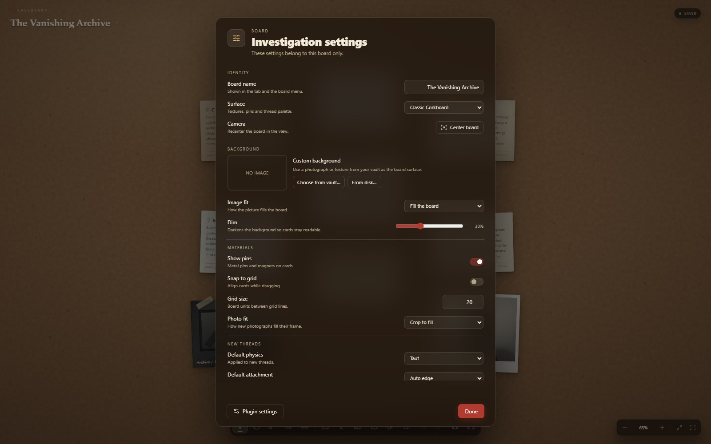

<div align="center">



# Caseboard

**Кинематографичная доска расследований для Obsidian.**

Заметки, фотографии, красные нити, булавки, скотч, лупа и импорт графа связей — всё локально, в вашем хранилище.

[](https://github.com/ZekiTRR/CaseBoard/releases/latest)
[](https://obsidian.md)
[](https://github.com/ZekiTRR/CaseBoard/actions/workflows/ci.yml)
[](LICENSE)

[English](README.en.md) · [Возможности](#-возможности) · [Галерея](#-галерея) · [Установка](#-установка) · [Сборка](#-сборка)

</div>

---

## ✨ Возможности

- **Несколько досок расследований** с отдельными названиями, темами, камерой и историей изменений.
- **Заметки, текст и фотографии** — перетаскивайте материалы из хранилища или добавляйте файлы с диска.
- **Красные нити** с динамической, натянутой и статической физикой, провисанием, натяжением и легким покачиванием.
- **Свободный скотч** — инструмент рядом с лупой позволяет клеить скотч на заметки, фотографии и пустую доску.
- **Произвольный стиль скотча** — цвет через колорпикер, длина, ширина и поворот.
- **Цвет булавки** — сохраненные пресеты темы плюс собственный цвет через колорпикер.
- **Режим Bare** — карточка или фото без рамки, булавки и скотча.
- **Лупа и глубокое масштабирование** — рассматривайте плотный текст без изменения всей доски.
- **Плавное перемещение** — колесо мыши, трекпад, рука и мягкое инерционное движение камеры.
- **Импорт связанных заметок** — граф, рекурсия, фильтры по папкам, тегам и свойствам, повторное обновление цепочек.
- **5 тем оформления** — пробка, темное расследование, бетон, винтаж и маркерная доска.
- **Свой фон доски** — изображение из хранилища или с диска, режимы заполнения и затемнение.
- **Локальное хранение** — файлы досок не зависят от заметок и не отправляются никуда.
- **Хоткеи на любой раскладке** — сочетания работают по физическому положению клавиш, включая русскую раскладку.

---

## 🖼 Галерея

### Темы

<table>
  <tr>
    <td width="50%"></td>
    <td width="50%"></td>
  </tr>
  <tr>
    <td></td>
    <td></td>
  </tr>
</table>

### Материалы и инструменты

<table>
  <tr>
    <td width="50%"></td>
    <td width="50%"></td>
  </tr>
  <tr>
    <td></td>
    <td></td>
  </tr>
</table>

### Импорт и настройки

<table>
  <tr>
    <td width="50%"></td>
    <td width="50%"></td>
  </tr>
</table>

---

## 📦 Установка

### Через релиз

1. Откройте [Releases](https://github.com/ZekiTRR/CaseBoard/releases/latest).
2. Скачайте `caseboard.zip`.
3. Распакуйте архив в папку:

   ```text
   <vault>/.obsidian/plugins/caseboard/
   ```

4. В Obsidian откройте **Settings → Community plugins** и включите **Caseboard**.

### Через BRAT

1. Установите плагин **BRAT**.
2. Добавьте экспериментальный репозиторий:

   ```text
   ZekiTRR/CaseBoard
   ```

3. Нажмите **Check for updates** и включите плагин.

### Вручную

Склонируйте репозиторий, выполните [сборку](#-сборка) и скопируйте `main.js`, `styles.css` и `manifest.json` в папку плагина.

---

## 🧭 Как пользоваться

- Откройте доску через иконку булавки на левой панели или командой **Open Caseboard**.
- Добавляйте заметки, текст и фотографии кнопками на нижней панели инструментов.
- Выберите инструмент **Thread**, затем две карточки, чтобы связать их нитью.
- Выберите инструмент **Tape** и протяните полосу скотча по доске или поверх любой карточки.
- Выделите скотч, чтобы открыть панель **Material** и изменить цвет, длину и ширину.
- Правый клик по карточке открывает режимы материала, цвет булавки, блокировку, порядок и удаление.

### Горячие клавиши

| Действие | Клавиша |
| --- | --- |
| Выбор | `V` |
| Рука | `H` |
| Нить | `C` |
| Лупа | `Z` |
| Скотч | `G` |
| Заметка | `N` |
| Текстовый блок | `T` |
| Фотография | `I` |
| Focus mode | `F` |
| Сохранить | `Ctrl + S` |
| Отменить | `Ctrl + Z` |
| Повторить | `Ctrl + Shift + Z` |
| Дублировать | `Ctrl + D` |
| Удалить | `Delete` |
| Отмена / закрыть | `Esc` |
| Вписать доску | `Shift + 1` |
| Вписать выделение | `Shift + 2` |
| Приблизить | `+` |
| Отдалить | `-` |

Сочетания определяются по физическому положению клавиши, поэтому работают и в русской раскладке.

---

## 🗂 Хранение

- Доски сохраняются в виде отдельных JSON-файлов и не изменяют ваши заметки.
- Папку досок можно выбрать в настройках плагина: **Board folder**.
- При переносе в другую папку существующие файлы досок автоматически перемещаются.
- Добавляемые изображения, фон и перетаскиваемые файлы сохраняются в **Attachment folder**.
- Если папка вложений не указана, Obsidian использует свои настройки вложений.

---

## 🛠 Сборка

Требуется Node.js 20 или новее.

```bash
npm ci
npm run build
```

После сборки появятся:

```text
main.js
styles.css
```

Для автоматического релиза создайте тег:

```bash
git tag v1.0.0
git push origin v1.0.0
```

GitHub Actions соберет плагин и опубликует архив `caseboard.zip` в разделе Releases.

---

## 📄 Лицензия

[MIT](LICENSE)
