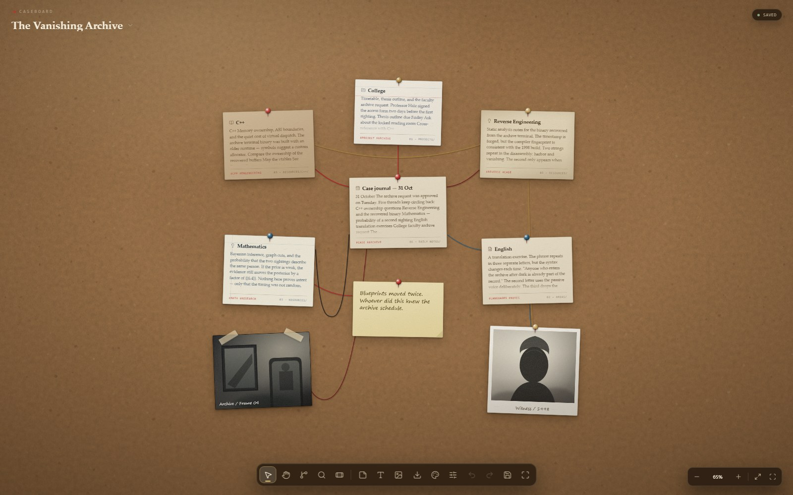
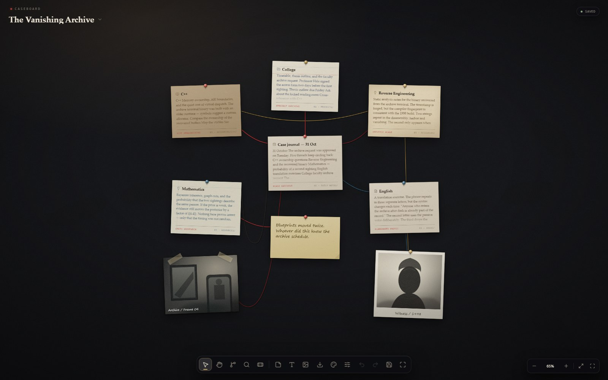
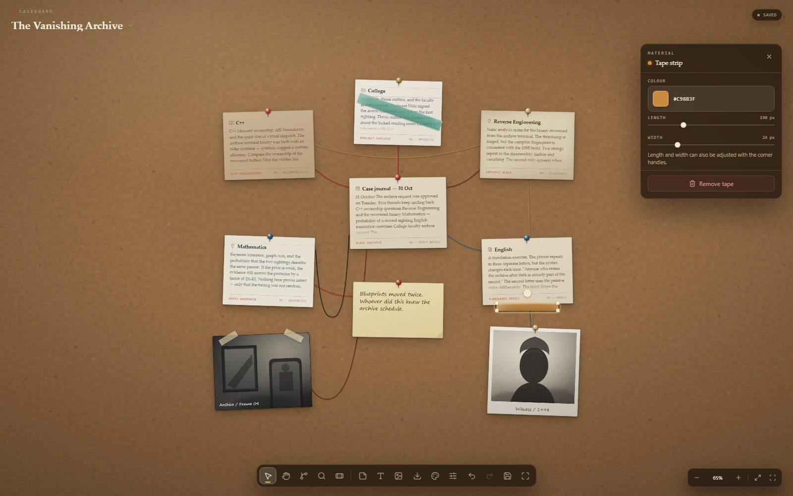
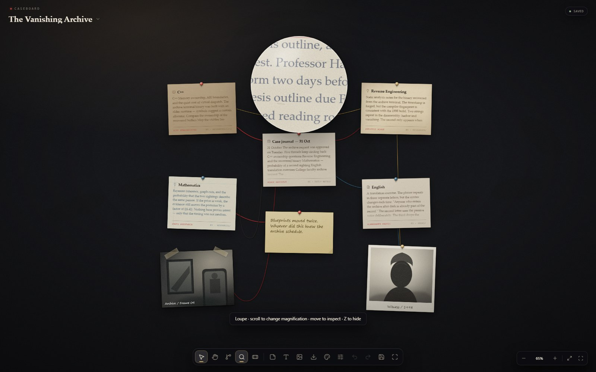
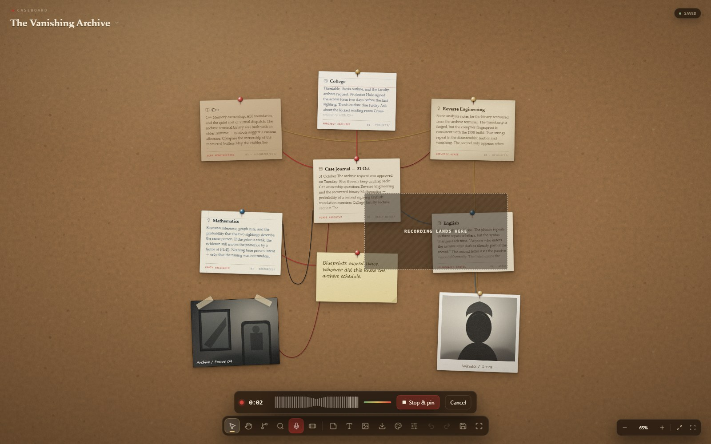
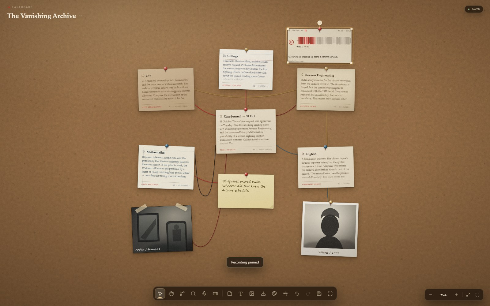
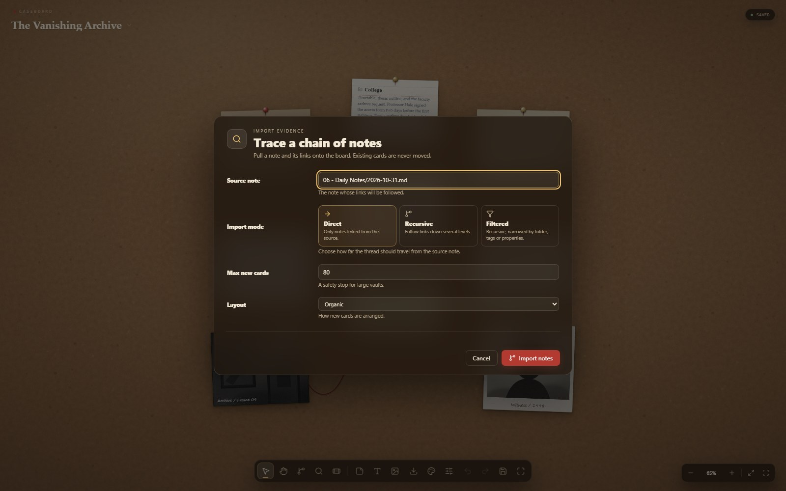
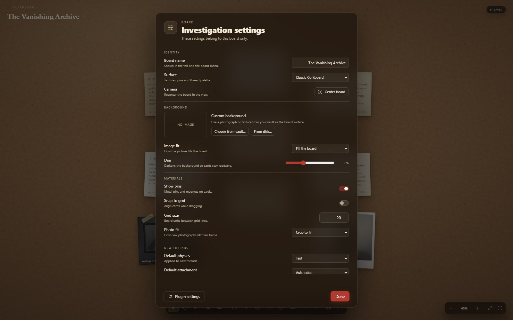

# Caseboard

**Кинематографичная доска расследований для Obsidian.**

Булавьте заметки, фотографии и улики на пробковую доску, связывайте их красными нитями и импортируйте связанные заметки из хранилища. Всё считается плагином и хранится локально — наружу не уходит ничего.

[](https://github.com/ZekiTRR/CaseBoard/releases/latest)
[](https://obsidian.md)
[](https://github.com/ZekiTRR/CaseBoard/actions/workflows/lint.yml)
[](LICENSE)

[English](README.md) · [Возможности](#-возможности) · [Галерея](#-галерея) · [Установка](#-установка) · [Приватность](#-приватность-и-хранение) · [Сборка](#-сборка-и-релиз)

---

## ✨ Возможности

- **Несколько досок** — у каждой своё название, тема, положение камеры и история отмен.
- **Заметки, текст и фотографии** — из хранилища или с диска.
- **Диктофон** — запись голоса прямо на доске: карточка с волной из реальных пиков файла, длительностью и подписью.
- **Красные нити** с динамической, натянутой и статической физикой, провисанием, авто-натяжением и лёгким покачиванием.
- **Свободный скотч** — инструмент клеит ленты на карточки и прямо на пустую доску.
- **Произвольный стиль скотча** — колорпикер, длина, ширина и поворот.
- **Цвет булавки** — пресеты темы остаются, любой цвет добавляется через колорпикер.
- **Режим Bare** — карточка или фото без рамки, булавки и скотча.
- **Лупа** с настраиваемым увеличением, независимым от масштаба доски.
- **Плавная навигация** — колесо мыши и трекпад, инструмент «рука», мягкое инерционное движение камеры.
- **Импорт связанных заметок** — граф, рекурсия, фильтры по папкам, тегам и свойствам, обновление цепочки.
- **Пять тем** — пробка, тёмное расследование, бетон, винтажная бумага, маркерная доска.
- **Свой фон доски** — изображение из хранилища или с диска, режимы заполнения и затемнение.
- **Хоткеи на любой раскладке** — сочетания привязаны к физическому положению клавиши, работает и русская раскладка.

---

## 🖼 Галерея

**Тема «тёмное расследование».**



**Инструмент скотча и панель материала.**



**Лупа с настраиваемым увеличением.**



**Диктофон — идёт запись.**



**Голосовая карточка с волной из записанного файла.**



**Импорт связанных заметок.**



**Настройки доски.**



Другие темы и режимы: [пробка](assets/screenshots/hero-cork.jpg), [бетон](assets/screenshots/theme-concrete.jpg), [винтаж](assets/screenshots/theme-vintage.jpg), [маркерная доска](assets/screenshots/theme-whiteboard.jpg), [Bare-заметка](assets/screenshots/bare-note.jpg), [колорпикер булавки](assets/screenshots/pin-color.jpg).

---

## 📦 Установка

### Из каталога сообществ

1. Откройте **Settings → Community plugins → Browse** в Obsidian.
2. Найдите **Caseboard**, установите и включите.

### Из релиза на GitHub

1. Скачайте `main.js`, `manifest.json` и `styles.css` из [последнего релиза](https://github.com/ZekiTRR/CaseBoard/releases/latest).
2. Скопируйте все три файлы в хранилище:

   ```text
   <vault>/.obsidian/plugins/caseboard/
   ```

3. Откройте **Settings → Community plugins** и включите **Caseboard**.

### Через BRAT

Добавьте экспериментальный репозиторий `ZekiTRR/CaseBoard`, нажмите **Check for updates** и включите плагин.

---

## 🧭 Работа с доской

- Доска открывается иконкой булавки на левой панели или командой **Open the board**.
- Заметки, текст и фотографии добавляются кнопками на панели инструментов.
- Выберите инструмент **Thread** и кликните две карточки, чтобы связать их нитью.
- Выберите инструмент **Tape** и протяните полосу по доске или поверх карточки; клик даёт короткую ленту.
- Нажмите **Диктофон** (или `R`) и говорите: полоса над панелью показывает уровень, а **Stop & pin** кладёт карточку туда, где курсор.
- Клик по чернильному кругу проигрывает запись, клик по волне перематывает, правый клик по карточке — подпись.
- Выделите скотч, чтобы открыть панель **Material** и изменить цвет, длину и ширину.
- Правый клик по карточке открывает режим материала, цвет булавки, блокировку, порядок и удаление.

### Горячие клавиши

| Действие | Клавиша |
| --- | --- |
| Выбор | `V` |
| Рука | `H` |
| Нить | `C` |
| Лупа | `Z` |
| Скотч | `G` |
| Диктофон | `R` |
| Заметка | `N` |
| Текстовый блок | `T` |
| Фотография | `I` |
| Focus mode | `F` |
| Сохранить | `Ctrl + S` |
| Отменить / повторить | `Ctrl + Z` / `Ctrl + Shift + Z` |
| Дублировать | `Ctrl + D` |
| Удалить | `Delete` |
| Отмена / закрыть | `Esc` |
| Вписать доску / выделение | `Shift + 1` / `Shift + 2` |
| Приблизить / отдалить | `+` / `-` |

Сочетания привязаны к физическому положению клавиши, поэтому работают и в русской раскладке.

Доска рассчитана на десктоп: используются наведение указателя, колесо мыши и системный выбор файла.

---

## 🔒 Приватность и хранение

- **Сеть не используется.** Плагин не делает запросов, не загружает удалённый код и не отправляет статистику.
- **Микрофон.** Диктофон запрашивает доступ к микрофону в момент нажатия `R` или кнопки **Диктофон**. Запись идёт через `MediaRecorder`, волна считается на вашем устройстве и сохраняется в хранилище; микрофон освобождается сразу после остановки или отмены. Никуда ничего не транслируется.
- **Никакой телеметрии, аккаунтов и платных функций.**
- Доски хранятся обычными JSON-файлами внутри хранилища: **Settings → Caseboard → Board folder** (по умолчанию `.obsidian/plugins/caseboard/boards`).
- Добавляемые изображения, записи, фон и перетащенные файлы копируются в **Attachment folder**; если папку не задать, используются настройки вложений Obsidian.
- Параметры плагина лежат в `.obsidian/plugins/caseboard/data.json`.
- Исходные заметки только читаются. Плагин записывает файлы досок и выбранный вами каталог вложений. Удаление карточки не удаляет медиафайл.

---

## 🛠 Сборка и релиз

Нужен Node.js 20 или новее.

```bash
npm ci
npm run build     # проверка типов и сборка main.js, styles.css
npm run lint      # eslint с eslint-plugin-obsidianmd
```

Артефакты создаются в корне репозитория и намеренно не коммитятся — они публикуются в релизе:

```text
main.js
styles.css
```

Выпуск версии. `npm version` обновляет `manifest.json`, `package.json` и `versions.json`, затем создаёт тег без префикса `v`, как требует Obsidian:

```bash
npm version patch
git push origin main
git push origin 1.0.1
```

[Workflow релиза](.github/workflows/release.yml) собирает этот тег, подписывает provenance сборки и публикует GitHub Release с файлами `main.js`, `manifest.json` и `styles.css`.

Подача плагина в каталог сообществ выполняется на [community.obsidian.md](https://community.obsidian.md) — репозиторий должен быть публичным, а релиз опубликован.

---

## 📄 Лицензия

[MIT](LICENSE)
